# CrystalLens v1.1

CrystalLens 是一个面向 Windows 10/11 x64 的原生晶体结构查看与编辑工具。它使用 **C++17 + Win32 + OpenGL 3.3** 实现，不依赖 Qt 或其他第三方运行库，便携包包含 `CrystalLens.exe` 和可离线打开的晶体结构库。

## v1.1 配位多面体

在经典晶体库中打开岩盐，选“多面体”，每个 Na 中心周围的六个 Cl 构成八面体。对 2×2×2 超胞，关闭边界原子时有 32 个 Na 中心，开启后可见 63 个。边界中心的多面体也包含相邻周期晶胞提供的配体。萤石显示 CaF₈ 立方体，钙钛矿保留 TiO₆ 骨架。

若周期键无法构成三维配位壳，视图显示原子和已启用的键，并给出提示。图例、标签和鼠标拾取与实际显示的原子一致。

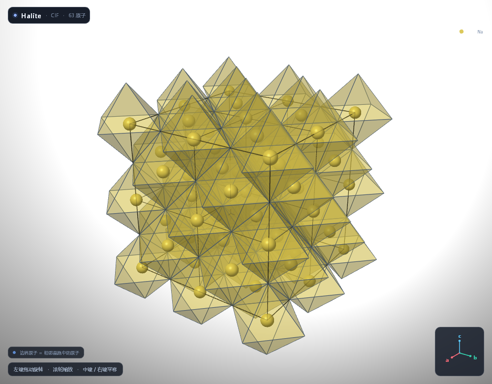

## v1.0 经典晶体库与多窗口

启动后点击视口中央的 **经典晶体库**。已打开晶体时，可从 **文件 → 经典晶体库** 或按 **Ctrl+L** 再次进入。双击一行打开晶体，或按住 Ctrl / Shift 多选后点击“打开”。每个晶体使用独立窗口，能分别旋转、测量、编辑和撤销。要并排比较，可用 Windows 的 Win+← / Win+→ 排列两个窗口。

| 结构 | 化学式 |
|---|---|
| 岩盐（氯化钠）、萤石 | NaCl、CaF₂ |
| 钙钛矿、硫铂矿 | CaTiO₃、PtS |
| 金红石、板钛矿、锐钛矿 | TiO₂ 的三种晶型 |
| 闪锌矿、纤锌矿（2H） | ZnS 的立方和六方晶型 |
| 金刚石、α-石英、方解石 | C、SiO₂、CaCO₃ |

12 份 CIF 均从 COD 的格拉纳达大学镜像取得，存放在程序旁的 `library` 文件夹，解压后可离线使用。数据编号、原始论文及下载文件的 SHA-256 见[晶体库来源](library/SOURCES.md)。

打开本地文件时也可多选或成组拖入。首个文件使用空窗口，后续每个文件新建一个窗口。关闭一个晶胞后，其余晶胞仍可继续操作。

## v0.9 配位多面体和大超胞

在左侧“外观”中选择“多面体”，点击同一栏的“设置”，或从“视图 → 外观设置…”打开面板。打开随包的 `examples/srtio3.cif` 可观察 TiO₆ 八面体，`examples/quartz.cif` 可观察 SiO₄ 四面体。

| 调节项 | 使用方法 |
|---|---|
| 面透明度 | 从 0% 的实心表面调至 100% 的线框显示。默认透明度为 66%。 |
| 多面体描边 | 调节 0–4 像素的线宽。0 关闭描边，默认为 1.2 像素。点击“多面体描边”色块，用色轮和明度条改色。 |
| 超胞 | 在“视图 → 超胞…”中分别输入 a、b、c 的 1–16 倍重复数。可只扩展一个方向，也可组合成立方体或薄层。 |

外观调整会实时显示，关闭面板后保存。多面体按凸包的真实棱描边，共面的多边形面只填充一次。渲染器为同一位点的周期副本复用面片拓扑，并按观察方向对半透明三角面排序。

每次扩展最多容纳 65,536 个内部位点和 300,000 条复制后的周期键，计入边界副本时最多显示 80,000 个位点。手动输入超出容量时可以在面板中修改。打开其他晶体时，若此前的超胞设置超出新结构容量，视口会显示单胞和提示。

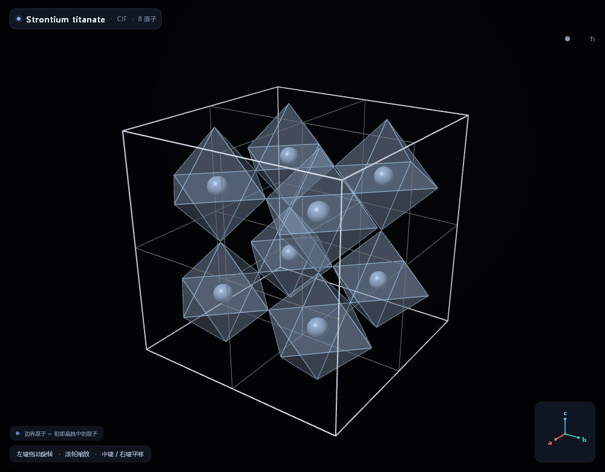

## v0.8 晶胞显示与结构读取

- 球棍、跨胞计数和配位多面体共用周期键表。每条键记录相邻原子和整数晶胞平移，支持同一位点的周期像，也能区分同一原子对的多个等距邻居。岩盐常规晶胞含 4 Na、4 Cl 和 24 条独立 Na–Cl 键。视口键数只计两个端点均在当前视图模型中的键。
- 斜晶胞的最近距离和键角按笛卡尔度量搜索。显示超胞时，相机以当前超胞及其可见几何为中心，边框与次级网格使用不同线宽。原子遮挡的外框以较低亮度显示。
- CIF 支持混排或跨行的循环数据、含撇号的引号字符串、单个位点的标量写法，以及带不确定度的指数数值。兼有两套坐标列时优先采用完整分数坐标，缺失时采用该行的完整笛卡尔坐标。普通笛卡尔坐标按软件的标准晶轴约定换算。多模型表读取首个模型。
- 保留 CIF 无序组和集合字段，同一集合中互斥组的位点之间跳过自动成键。未知元素显示为 X。XYZ 可读取原子序数。VESTA 导出 CIF 会保留对称操作的旋转和平移。
- 自动键按元素半径和距离推断。仅给出空间群名称或编号的文件沿用输入位点，并在结构备注中提示缺少显式对称操作。

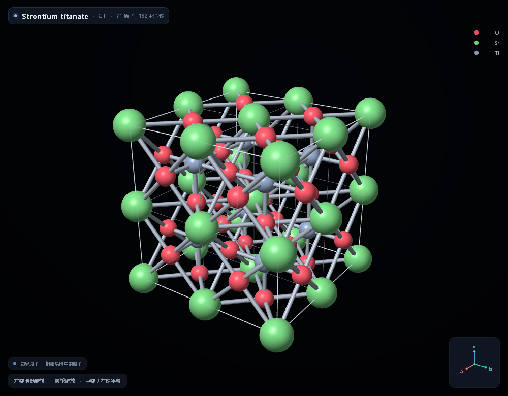

## v0.7 顺滑拖动、色轮与键连精修

- **键连更准确**：仍采用共价半径之和加距离容差，但按元素类别分配容差；CrCoBr₃ 现在显示 **20 个可见原子、12 条 Co–Br 键**，Cr 保持孤立。元素配色同步修正为 **Br 棕、Co 蓝、Cr 粉**。
- **平滑旋转**：鼠标拖动改为“目标角度 + 阻尼跟随”，释放后带短暂惯性并快速衰减；旋转速度与帧率无关，拖动时临时使用 8 ms 刷新节奏，减少顿挫。
- **外观色轮**：外观设置不再只是三个十六进制输入框，而是 HSV 色轮 + 明度滑杆 + 边框粗细滑杆；边框/背景色块可切换编辑对象。
- **实时预览**：拖动色轮、明度或边框粗细时，视口立即更新；只有关闭面板时才保存设置。
- **键连与取景延续 v0.6**：Bi₂Te₃ 保持 0 条 Bi–Te 键，KNiF₃ 的 K–F/Ni–F 配位保留，超胞和逐晶胞边框、多面体模式不变。

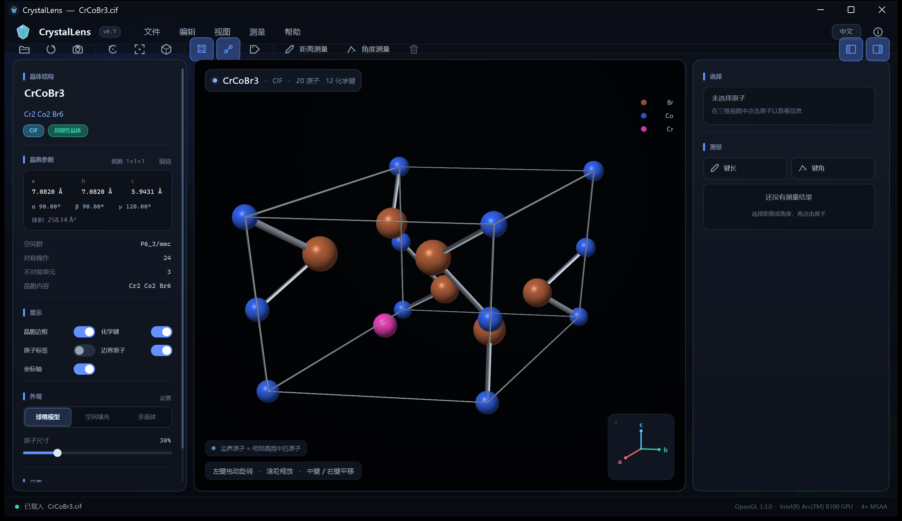

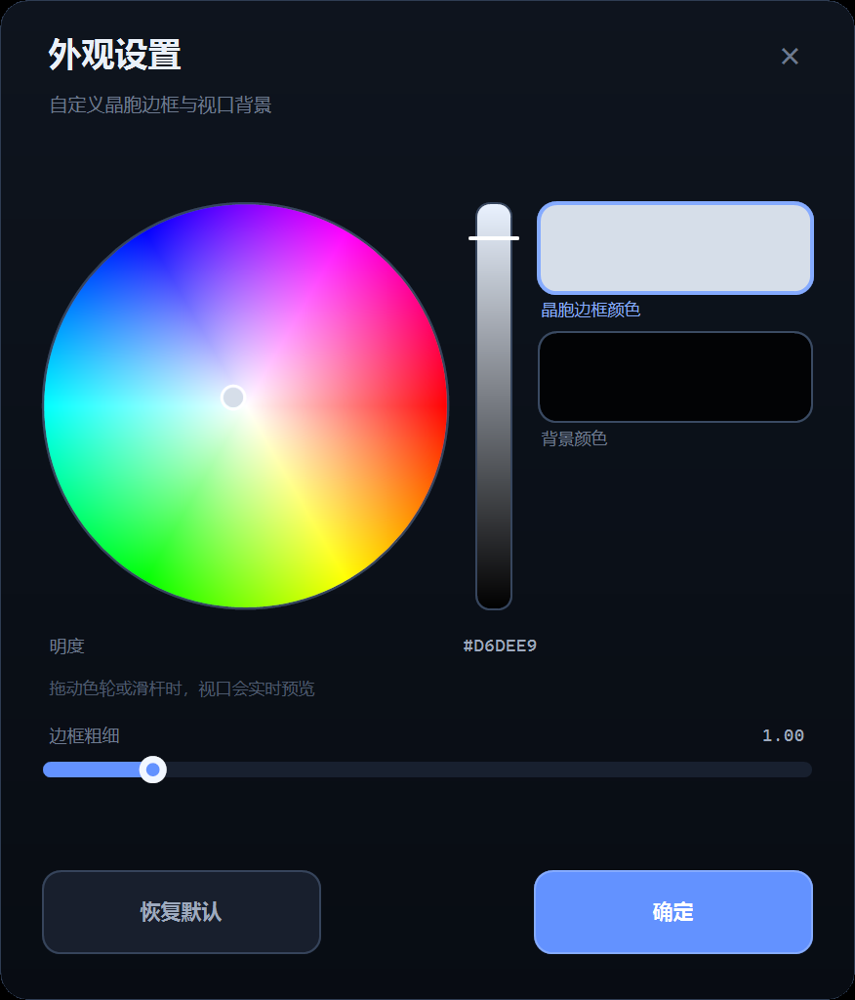

## v0.6 多面体、超胞网格与键连优化

- **键连规则修正**：不再是“按元素类别整体切断”，而是按 `r_cov(A)+r_cov(B)+容差` 判断距离。金属–非金属离子键使用较宽容差，保留 K–F、Ni–F、Na–Cl 等合理配位；Bi–Te 的 3.07–3.25 Å 超过容差，因此 Bi₂Te₃ 显示 **34 个可见原子、0 条化学键**。过渡金属之间较近的金属键仍会保留。
- **超胞内每个小晶胞单独框出**：2×2×2、3×3×3 等超胞会绘制全部内部晶胞边线，不再只画最外层大框。
- **多面体模型**：球棍/空间填充之外新增“多面体”样式。以 Si/Al/Ni 等中心原子生成完整配位多面体（四面体/八面体），半透明面 + 中心原子，配体与碱金属原子隐藏，便于观察配位骨架。
- **外观可自定义**：“视图 → 外观设置…”或左侧“外观”旁的“设置”，可修改晶胞边框颜色、边框粗细和视口背景颜色，保存到设置。
- **GPU 优化**：
  - 超胞晶胞网格和多面体使用独立静态 VBO/单次绘制，不随相机移动重建。
  - 晶胞网格从 CPU/GDI 叠层改为 GPU 半透明 overlay pass。
  - 拖动时临时提高刷新定时器至 8 ms，并避免悬停拾取/几何重建，超胞拖动更顺滑。
  - 继续使用实例化球体/键、缓存 uniform、按实例索引做选中/悬停。

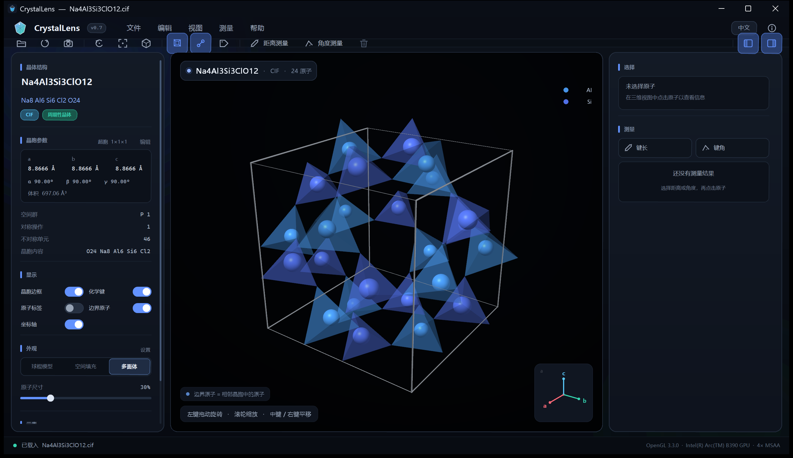

| Bi₂Te₃：0 条化学键 | 外观设置 |
|---|---|
| 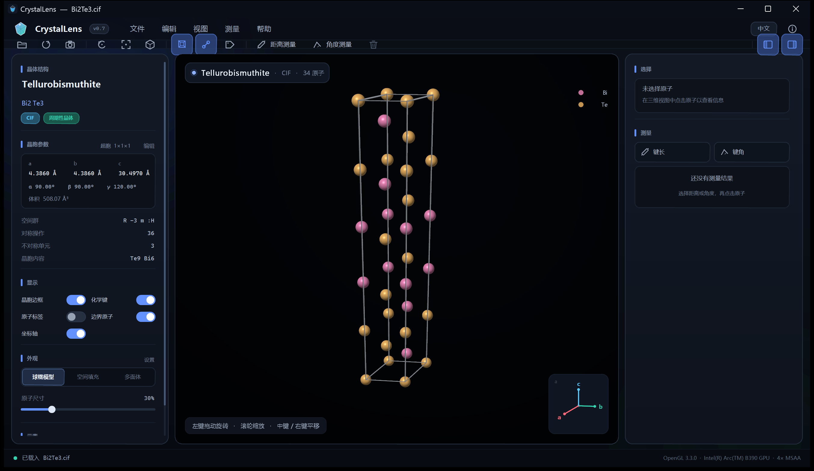 |  |

## v0.5 超胞与界面精修

- **可调超胞**：从“视图 → 超胞…”或左侧晶胞参数区的“超胞 N×N×N”打开设置，分别设置 a、b、c 方向重复次数（1–6），立即重建原子与键网络并适配视图。
- **与 CrystalMaker 可见位点一致**：
  - 本机验证的方钠石 `Na4Al3Si3ClO12` 为 46 个晶胞内原子；1×1×1 超胞 + 边界位点显示 **65 个可见原子**，与 CrystalMaker 的 65 完全一致。
  - KNiF₃ 在 2×2×2 超胞 + 边界位点显示 **71 个可见原子**，与参考截图一致。
  - 超胞框覆盖整个超胞；边界原子按 `[0,Nx]×[0,Ny]×[0,Nz]` 闭区间生成并去重。
- **键连规则修正（v0.5 版）**：金属–金属接触（如 K–K、K–Ni）不再被画成化学键；v0.6 起进一步改为距离容差规则，仅对过远接触截断。
- **界面更淡、更专业**：元素图例去掉深色圆角底板，只保留小圆点与符号；晶胞边框改为细、低透明度的浅灰线，不再使用醒目的蓝色发光线。
- **原子配色统一**：按专业软件习惯调整 Na（黄）、Al（蓝）、Si（蓝紫）、Cl（绿）、O（红）、K（紫）、Ni（银）；图例按元素符号排序。
- **视口背景**：改为近黑色、极弱渐晕，减少装饰性网格和彩色辉光，让晶胞与原子成为视觉主体。

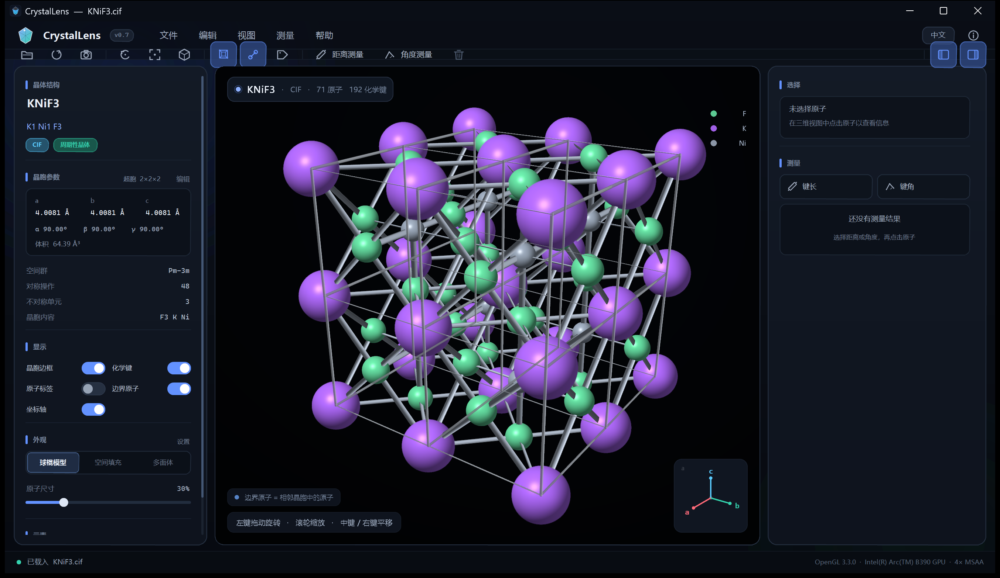

## v0.4 专业晶胞显示

- **边界原子默认开启**：以晶胞为中心生成一层相邻晶胞的完整原子，不再只显示 5 个晶胞内原子。KNiF₃ 示例从 5 个原子扩展到 **89 个可见原子、268 条键**，形成连续的钙钛矿晶格。
- **实心边界原子 + 完整配位**：边界原子与晶胞内原子使用相同材质，直接按显示集合搜索全部周期性键，不再只画最近的镜像键，也不会有悬空键或半透明“幽灵球”。
- **晶胞框叠加显示**：晶胞边框先正常深度绘制，再以半透明方式叠加一层，因此在致密的边界原子中仍然可见。
- **专业配色调和**：化学键统一为中性灰银色。过渡金属球采用共价半径缩放，非金属采用范德华半径，阳离子/阴离子的相对大小更合理。
- **元素图例**：视口右上角自动列出当前结构中的元素颜色和图例符号。
- **取景适配整个晶格片段**：相机适配边界原子后，晶胞和周围晶格完整进入视图。
- **可切换回晶胞内容**：左侧“显示 → 边界原子”关闭后，只显示晶胞内原子与晶胞内键，便于核对 CIF 的晶胞内容。

## v0.3 渲染与 CIF 修复

- **修正相机取景基准**：此前相机看向绝对晶胞中心，而几何体已经以结构中心为原点，导致结构偏心、偏小/偏大。v0.3 将相机目标统一为原点，晶胞和原子在视图中正确居中，取景尺寸更合理。
- **真正的 3D 化学键**：由面向相机的扁平条带改为 **6 面平滑法线圆柱**，一次实例化绘制全部键，具有正确的深度、光照和抗锯齿。
- **重做光照**：球体与圆柱使用主光、补光、双高光与边缘光，减少“塑料感”，层次更清楚。
- **默认原子尺寸与相对半径**：球棍模型默认原子半径 30%，过渡金属使用更小的共价半径，使阳离子与阴离子的比例更接近晶体学软件。
- **修正晶胞取景**：相机适配只使用晶胞角点与真实原子，不再被外围镜像原子撑大，晶胞始终位于视图核心区域。
- **GPU 调用优化**：缓存 uniform 位置；选择/悬停改为顶点着色器按实例索引判断，鼠标悬停不再重建和重传整个原子实例缓冲；原子/键/镜像各保持一次实例化 draw call。
- **CIF 兼容性**：支持没有引号的对称操作行（如 `x, y, z` 每行一个操作），修复了这类 CIF 被误判为无对称操作的问题；在本机 51 个真实 CIF 语料上全部成功载入。

## 功能总览

- **结构读取**：CIF（对称操作展开、带误差数字、多 data block 选择、无引号对称操作）、XYZ 分子文件、VESTA 文本文件（`CELLP` / `SYMOP` / `STRUC`）。
- **三维显示**：晶胞/超胞网格、化学键、原子标签、坐标轴、球棍/空间填充/多面体、透视/正交、最高 4× MSAA（驱动支持时）。
- **边界原子**：默认显示相邻晶胞中的一层实心原子和完整键网络；可一键关闭为晶胞内显示。边界原子不参与拾取。
- **交互**：旋转、平移、缩放、原子拾取、键长/键角测量、重置视角、适配视图。
- **编辑（v0.2 起）**：修改晶胞参数；添加、编辑、删除原子；撤销/重做；保存为 CIF 或 XYZ。
- **界面**：深色自绘菜单/工具栏/侧栏/状态栏/提示气泡/帮助；可自定义晶胞边框颜色/粗细与背景；高 DPI；文件拖放；截图；复制摘要。
- **中英文切换**：默认中文，可一键切到 English。

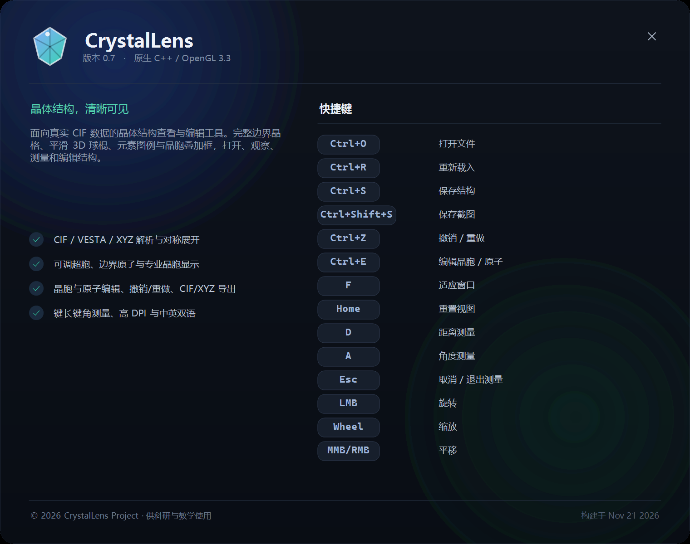

键长/键角测量使用周期性最小镜像距离，视口中绘制测量线并显示数值；中英文界面可随时切换。

## 编辑

### 编辑晶胞

从“编辑 → 编辑晶胞…”（`Ctrl+E`）、左侧晶胞参数区的“编辑”链接进入。应用后会重新展开对称原子、重建化学键并刷新摘要。

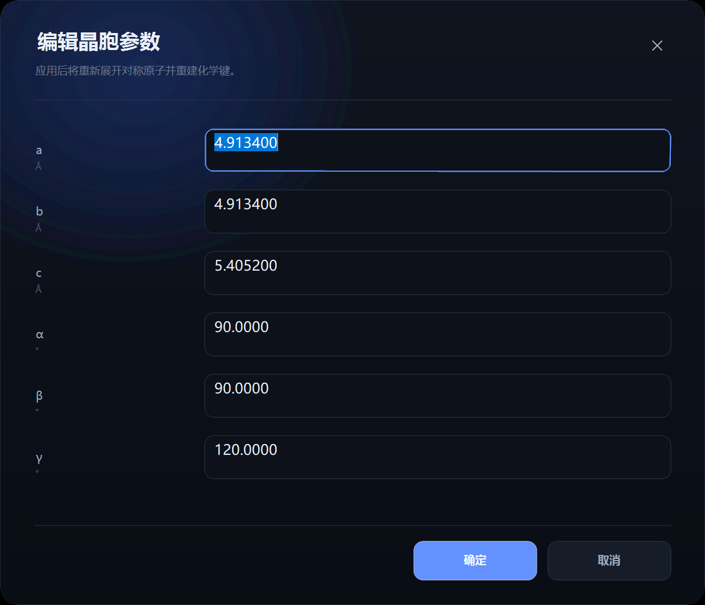

### 添加 / 编辑原子

- **添加原子**：`Ctrl+Shift+A`。周期结构输入分数坐标；分子输入笛卡尔坐标。元素可填元素符号或原子序数。
- **编辑原子**：选中原子后按 `F2`，或使用右侧“编辑原子”。
- **删除原子**：`Delete` 或右侧“删除”；可撤销。
- 编辑对象是不对称单元中的位点；该位点的所有对称等价原子会一起更新。占位率必须大于 0 且不超过 1。

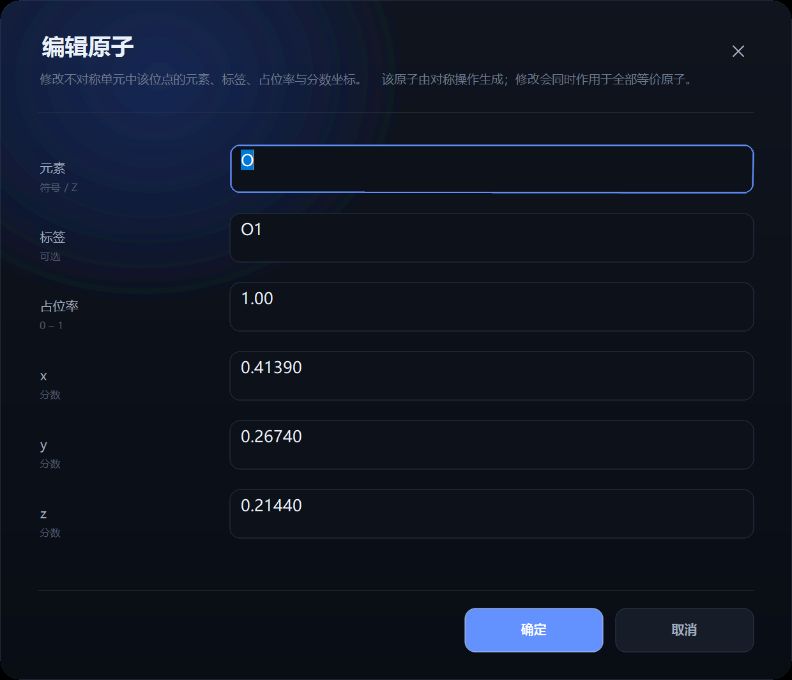

### 撤销 / 重做 / 保存

- `Ctrl+Z` 撤销，`Ctrl+Y` 重做，最多 50 步。
- `Ctrl+S` 保存结构：CIF（需晶胞，写不对称单元与对称操作）或 XYZ（当前显示原子）。保存后重新载入。
- 有未保存修改时，打开其他文件、重新载入或退出前会提示。

## 系统要求

| 项目 | 要求 |
|---|---|
| 操作系统 | Windows 10 1809+ / Windows 11，64 位 |
| 处理器 | 支持 SSE2 的 x64 处理器 |
| 显卡 | 支持 OpenGL 3.3 Core 的显卡/驱动（不支持时程序会给出提示） |
| 运行库 | 无需安装 Visual C++ 运行库，程序静态链接 CRT |
| 硬盘 | 便携包约 5 MB（含结构库、示例和截图） |

程序通过清单启用 Per-Monitor V2 DPI 感知和 UTF-8 活动代码页，并通过 DWM 设置深色标题栏；已在 2880×1800 / 200% 缩放下验证。

## 快速开始

1. 解压 `CrystalLens-v1.1.0-win64.zip`。
2. 运行 `CrystalLens.exe`。
3. 打开或拖入结构文件。示例包括：
   - `examples/quartz.cif`（α-石英）
   - `examples/diamond.cif`（金刚石）
   - `examples/srtio3.cif`（SrTiO₃）
   - `examples/nacl.vesta`（NaCl，VESTA 格式）
   - `examples/water.xyz` / `examples/benzene.xyz`（分子）
4. 鼠标旋转/缩放；右侧测量；`Ctrl+E` 编辑晶胞；选中原子后 `F2` 编辑原子。
5. 左侧晶胞参数区的“超胞 N×N×N”可打开超胞设置；“视图 → 超胞…”也可以。
6. “外观”区域可切换球棍/空间填充/多面体，并打开外观设置修改边框和背景。
7. 若要只查看晶胞内原子，关闭左侧“显示 → 边界原子”；重新打开可显示完整配位。

也可以在命令行传入一个或多个文件路径。

```powershell
.\CrystalLens.exe library\rutile.cif library\brookite.cif
```

## 操作说明

### 鼠标

| 操作 | 功能 |
|---|---|
| 左键拖动 | 旋转 |
| 滚轮 | 缩放 |
| 中键拖动 / 右键拖动 | 平移 |
| 左键单击原子 | 选择原子并在右侧显示信息 |
| 测量模式左键单击原子 | 键长（2 个原子）/ 键角（3 个原子） |
| 右侧“编辑原子 / 删除” | 编辑或删除选中原子 |
| 左侧“编辑”链接 | 编辑晶胞参数 |
| 左侧“边界原子”开关 | 显示/隐藏相邻晶胞原子和完整键网络 |
| 左侧“超胞 N×N×N” | 打开 a/b/c 方向 1–16 倍的超胞设置 |
| 左侧“外观” → “设置” | 修改晶胞边框颜色/粗细、视口背景颜色 |
| “外观”样式段 | 球棍 / 空间填充 / 多面体三种显示模式 |

### 键盘

| 快捷键 | 功能 |
|---|---|
| `Ctrl+L` | 打开经典晶体库 |
| `Ctrl+O` | 打开文件 |
| `Ctrl+R` | 重新载入 |
| `Ctrl+S` | 保存结构 |
| `Ctrl+Shift+S` | 保存视口截图 |
| `Ctrl+Z` / `Ctrl+Y` | 撤销 / 重做 |
| `Ctrl+E` | 编辑晶胞 |
| `Ctrl+Shift+A` | 添加原子 |
| `F2` | 编辑选中原子 |
| `Delete` | 删除选中原子 |
| `Ctrl+C` | 复制结构摘要 |
| `F1` | 帮助 |
| `F` | 适配视图 |
| `Home` | 重置视角 |
| `D` / `A` | 键长 / 键角测量 |
| `Esc` | 退出测量模式或取消选择 |
| `C` / `B` / `L` | 显示/隐藏晶胞 / 化学键 / 原子标签 |
| `P` | 透视 / 正交投影 |
| `↑ ↓ ← →` | 旋转 |
| `+` / `-` | 缩放 |

截图自动保存到 `图片\CrystalLens`；若不可写则回退到 `%LOCALAPPDATA%\CrystalLens\Screenshots`、系统临时目录或当前工作目录，并在状态栏显示路径。

### 配置与卸载

- 便携版，不写注册表，不安装服务。
- 设置保存在 `%APPDATA%\CrystalLens\settings.ini`；删除该文件恢复默认。
- 卸载只需删除解压目录，以及需要清理的设置/截图目录。

## 支持的文件

### CIF

- 常见 cell、空间群、对称操作、原子分数/笛卡尔坐标、占位、标签。
- 支持 `_symmetry_equiv_pos_as_xyz` / `_space_group_symop_operation_xyz`，包括无引号、带空格的逐行对称操作。
- 多 `data_` block 选择原子数最多的 block。
- 数字支持 `1.234(5)`、`0.5`、`1/3`。
- 不处理无序/部分占位精修、各向异性热振动、磁矩。
- 如果 CIF 只给空间群名称而没有显式操作，程序不会从空间群数据库补全操作。
- 导出 CIF 需要晶胞，写入当前不对称单元与已有对称操作。

### XYZ

- 标准 XYZ；无晶胞，按共价半径猜测化学键。
- 未知元素按碳处理并保留原始标签。
- 导出 XYZ 写出当前显示的全部原子（周期性结构为整个晶胞的笛卡尔坐标）。

### VESTA

- 文本格式的 `TITLE`、`CELLP`、`GROUP`、`SYMOP`、`STRUC`。
- 不读取 `BOUND`、`POLYHEDRA`、`VECTR` 等高级记录。

## 构建

依赖：

- Visual Studio 2022 或 2026，安装“使用 C++ 的桌面开发”和 Windows 10/11 SDK。
- CMake 3.25+（VS 2026 需要 CMake 4.x）。
- 无第三方库。

### 一键构建

```powershell
.\build.ps1
```

PowerShell 执行策略禁止脚本时：

```powershell
powershell -ExecutionPolicy Bypass -File .\build.ps1
```

产物在 `build\Release\CrystalLens.exe`。

### 手动构建

```powershell
cmake -S . -B build -G "Visual Studio 18 2026" -A x64
cmake --build build --config Release --parallel
ctest --test-dir build -C Release --output-on-failure
```

使用 Visual Studio 2022 时将生成器换成 `"Visual Studio 17 2022"`。

### 打包

```powershell
.\pack.ps1
```

生成 `dist\CrystalLens-v1.1.0-win64.zip`。

## 项目结构

```text
src/
  main.cpp              Win32 入口、DPI/COM/GDI+ 初始化
  core/                 CIF/XYZ/VESTA 解析、对称展开、键搜索、测量、编辑、导出
  render/               OpenGL 上下文、相机、实例化球/圆柱、拾取
  ui/                   主窗口、视口、菜单/工具栏/侧栏、编辑表单、国际化、设置
tests/
  test_core.cpp         解析、对称、键、测量、编辑、CIF/XYZ 导出
  test_camera.cpp       相机取景、投影、拾取
examples/               CIF / XYZ / VESTA 示例
resources/              图标、版本资源、DPI 清单
docs/                   截图
```

### 实现要点

- 球体使用实例化 impostor：四边形面向相机，片段着色器做射线-球求交并写 `gl_FragDepth`，边缘以 alpha-to-coverage 抗锯齿。
- 化学键由几何着色器生成 6 面平滑法线圆柱，一个实例化 draw call 绘制全部键；深度与光照为真实几何。
- 球体与圆柱共享主光/补光/双高光/边缘光模型。
- 选择与悬停通过每实例索引 + uniform 在顶点着色器中计算，避免鼠标移动时重建 VBO。
- 相机目标为渲染空间原点；取景使用超胞角点与当前显示原子，超胞尺寸变化后自动重新适配。
- 显示集合按超胞闭区间 `[0,Nx]×[0,Ny]×[0,Nz]` 生成，并按坐标去重；键网络在显示集合上用空间网格近邻搜索。成键条件为共价半径和 + 容差（金属–非金属较宽，其余较紧），因此 Bi₂Te₃ 的远距离 Bi–Te 接触不连，而 K–F/Ni–F 等正常配位保留。
- 超胞的每个小晶胞边线一次批量生成，并在 GPU 半透明 overlay pass 中绘制，因此 2×2×2/3×3×3 超胞的每个小胞边框都可见，且不依赖逐帧 CPU 投影。
- 多面体模式对每个中心原子搜索完整周期性配位（不受当前边界原子是否显示的限制），在 CPU 端构建凸包三角形后上传为静态 VBO；玻璃半透明面与中心原子一次绘制。
- 晶胞边框颜色/粗细和视口背景颜色保存在设置中；边框 overlay、GL 边框及背景 shader 共用这些参数。
- 编辑使用快照撤销栈；提交前验证完整结构，失败不修改模型。
- 表单用原生 `EDIT` 子控件处理输入/IME/剪贴板，自绘外框与按钮保持统一视觉。
- UI 全部自绘，字体、圆角、渐变、阴影由 GDI+ 与矢量路径绘制。

## 测试与性能

```powershell
build\Release\crystal_tests.exe
build\Release\crystal_camera_tests.exe
```

当前结果：

```text
crystal_tests:        407 checks passed, 0 failed
crystal_camera_tests: 305 checks passed, 0 failed
```

覆盖解析、对称展开、无引号对称操作、去重、键搜索、最小镜像测量、晶胞修改、原子增删改、CIF/XYZ 导出往返。

历史版本 CPU 侧基准（Release x64）：

| 场景 | 数据量 | 结果 |
|---|---|---|
| 合成简单立方 XYZ 载入 + 建键 | 10,648 原子 / 30,492 键 | 32.5 ms |
| 强制重建全部化学键 | 30,492 键 | 11.3 ms |

基础结构的原子和键上限分别为 30,000 / 150,000，均使用实例化绘制；性能关键路径已缓存 uniform 并避免悬停时重传实例缓冲。

## 已知限制

- 相机/取景已修正，但不同 CIF 的文件作者可能提供了不一致的对称操作；本程序按文件中的操作展开，无法自动纠正坏数据。遇到异常配位可检查 CIF 的 `_space_group_symop` / `_symmetry_equiv_pos_as_xyz`。
- 未实现无序、部分占位精修、各向异性热振动、磁矩。
- 多面体模式支持 4–14 个不同配位点构成的三维凸包。
- CIF 仅写不对称单元；XYZ 会丢失晶胞与周期性。
- 没有安装程序；发布包为便携 zip。

## 第三方与许可

- 无第三方运行时库；使用 Windows SDK（Win32、GDI+、DWM、Common Dialogs、OpenGL `opengl32`）。
- MIT License，详见 [LICENSE](LICENSE)。
