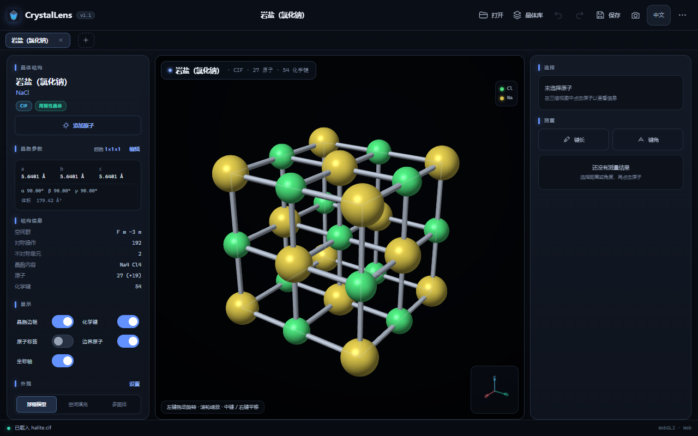
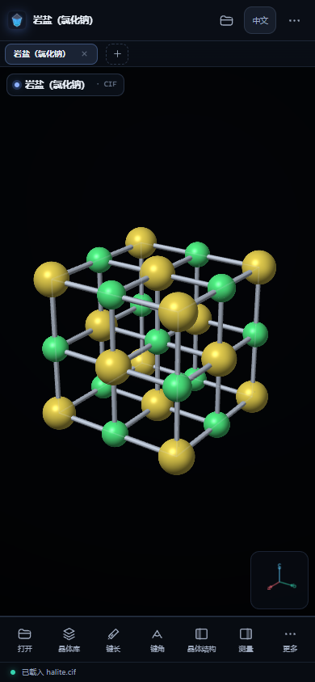
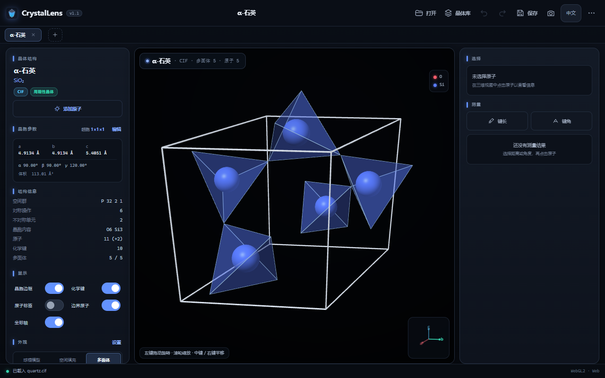
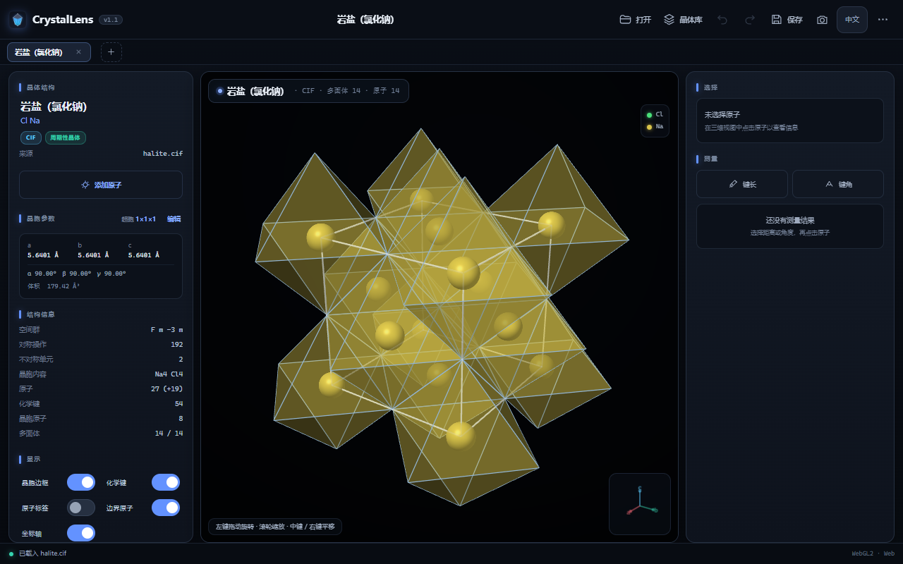
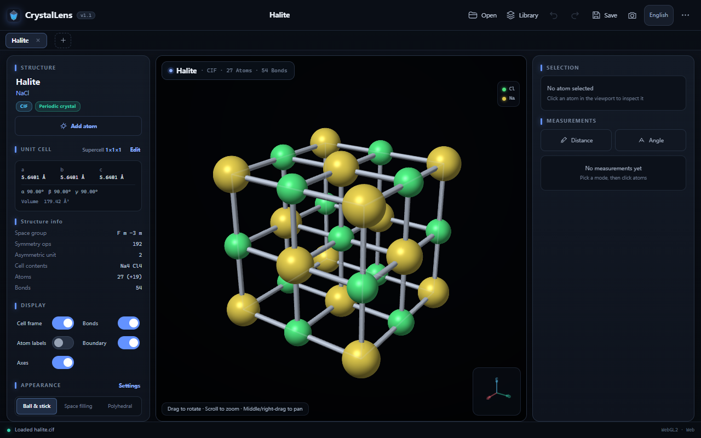
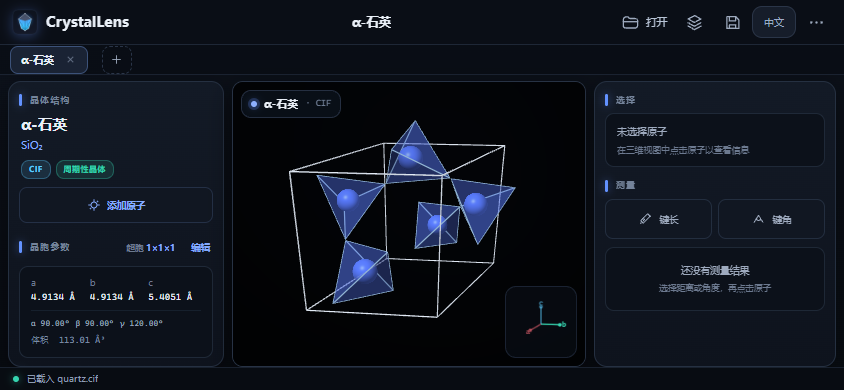

# CrystalLens for Android v1.1.0

> 将 [CrystalLens v1.1.0](../README.md)（Windows 原生 C++17 / Win32 / OpenGL 3.3 晶体结构查看与编辑器）重构为**可在安卓设备运行**的项目：
> **免安装网页预览版** + **可安装的签名 APK**，两者共享同一套 Web 核心代码。

[](../releases/tag/v1.1.0)
[](../releases/tag/v1.1.0-android)
[](LICENSE)

| 桌面版（原 C++ 程序） | 安卓版（本目录） |
|---|---|
| `CrystalLens.exe`，Win32 + OpenGL 3.3 | Java WebView 宿主 + WebGL2 核心，支持 Android 7.0+ |

---

## ⬇️ 下载

| 文件 | 说明 | 大小 |
|---|---|---|
| **[CrystalLens-v1.1.0-android.apk](../releases/download/v1.1.0-android/CrystalLens-v1.1.0-android.apk)** | **打包版**：已签名 APK（v2/v3），侧载安装 | 540 KB |
| **[CrystalLens-Android-Preview.html](../releases/download/v1.1.0-android/CrystalLens-Android-Preview.html)** | **免安装预览版**：单文件，离线可用，手机 Chrome 直接打开 | 1.13 MB |
| [CrystalLens-v1.1.0-android.zip](../releases/download/v1.1.0-android/CrystalLens-v1.1.0-android.zip) | 完整分发包（APK + 预览 + preview 目录 + 校验清单） | 1.43 MB |
| [Windows v1.1.0](../releases/tag/v1.1.0) | 原 Windows 版（exe / 源码 zip） | — |

APK：`com.crystallens.android` · versionName `1.1.0`（versionCode 110）· minSdk 24 / targetSdk 36 · 仅 `VIBRATE` 普通权限（无网络、无存储权限）。

## 📸 截图

| 桌面（1280×800） | 手机竖屏（390×844） |
|---|---|
|  |  |

| 配位多面体（α-石英 2×2×2） | 多面体（岩盐） |
|---|---|
|  |  |

| 英文界面 | 横屏 + 多面体 |
|---|---|
|  |  |

---

## ✨ 功能（对齐 Windows v1.1）

- **结构读取**：CIF（对称操作展开、`1.234(5)` 不确定度数字、多 data block、无引号逐行对称操作、无序组/集合）、XYZ（元素符号/原子序数）、VESTA（`CELLP`/`GROUP`/`SYMOP`/`STRUC`）。
- **三维显示**：晶胞/超胞（1–16 倍）网格、每个子晶胞边线、周期化学键、球棍 / 空间填充 / **配位多面体**（半透明面 + 像素级描边）、元素图例、原子标签、坐标轴 gizmo、透视/正交。
- **边界原子**：默认显示相邻晶胞的一层实心原子与完整键网络，可一键关闭；边界原子不参与拾取。
- **交互**：单指旋转（带惯性）、双指缩放/平移、双击适配、点击/长按拾取；桌面端保留鼠标操作与键盘快捷键。
- **测量**：键长（2 原子）/ 键角（3 原子）测量，使用周期性最小镜像，画面绘制测量线与数值。
- **编辑**：晶胞参数、添加/编辑/删除原子（作用于不对称单元，对称等价位点一起更新）、50 步撤销/重做。
- **导出**：CIF（含晶胞/对称操作）、XYZ（当前结构笛卡尔坐标）、PNG 截图、复制结构摘要。
- **界面**：移动优先布局（抽屉面板 + 底部弹层 + 标签页）、深色专业视觉、中英文界面、外观设置（边框颜色/粗细、背景色、多面体透明度/描边）与设置持久化。
- **离线晶体库**：岩盐、萤石、钙钛矿、硫铂矿、金红石、板钛矿、锐钛矿、闪锌矿、纤锌矿、金刚石、α-石英、方解石（12 份 CIF，来自 COD，署名见 [web/data/library/SOURCES.md](web/data/library/SOURCES.md)）。

## 🚀 快速开始

### 1) 免安装预览版（无需安装）

1. 下载 `CrystalLens-Android-Preview.html`；
2. 发送到手机（文件传输/网盘/邮件均可），用 **Chrome** 打开；
3. 点击首屏「经典晶体库」即可开始。完全离线，无网络请求。

也可以在 PC 上双击用浏览器打开，或本地 HTTP 预览：

```bash
python tools/serve_preview.py          # 打印 http://<电脑IP>:8000/，手机与电脑同 Wi-Fi 可访问
```

### 2) 安装 APK

1. 下载 `CrystalLens-v1.1.0-android.apk`，在手机上点击安装（按提示允许「安装未知应用」）；
2. 或使用 ADB：`adb install -r CrystalLens-v1.1.0-android.apk`；
3. 在文件管理器中用「打开方式 → CrystalLens」可直接打开 `.cif / .xyz / .vesta` 文件。

> 系统要求：Android 7.0+（API 24），WebView 支持 WebGL2（Chrome/WebView 56+，现代设备均满足）。
> APK 使用调试证书签名（`CN=CrystalLens Debug`），如要上架/正式分发请用你自己的发布证书重新签名。

### 3) 从源码构建

依赖：Windows 10/11 x64 + Python 3.10+ + Node.js 18+（仅测试需要）；JDK 17 与 Android SDK build-tools/platform 由脚本自动下载到 `.toolchain/`（约 300 MB，已 gitignore）。

```powershell
# 1) 下载工具链（仅首次）
powershell -ExecutionPolicy Bypass -File tools\fetch_toolchain.ps1

# 2) 全流程：内嵌晶体库 -> 预览版 -> Node 单测 -> 无头自检 -> 构建并签名 APK
powershell -ExecutionPolicy Bypass -File tools\build_all.ps1

# 3) 组装发布包（dist\CrystalLens-v1.1.0-android\ 与 .zip）
powershell -ExecutionPolicy Bypass -File tools\release.ps1
```

单独步骤：

```powershell
python tools\gen_library.py     # web/data -> 内嵌 web/js/data/library.js
python tools\build_web.py       # 生成 dist/preview 与单文件 CrystalLens-Android-Preview.html
node tests\node\run.js          # 190 项单元/验收测试（解析/对称/成键/超胞/多面体/测量/编辑/导出）
node tests\headless\run_suite.cjs   # 无头 Chromium 渲染截图套件（14 场景）
powershell -File tools\build_apk.ps1  # 仅构建 APK（无需 Gradle/AndroidX）
```

产物目录 `dist/`：

```
dist/
  CrystalLens-Android-Preview.html   单文件免安装预览版
  preview/                           目录版预览（本地 HTTP 托管）
  CrystalLens-v1.1.0-android.apk     签名 APK
  build-info.json  SHA256SUMS.txt  VERSION.txt
```

## 🏗 架构

原版约 4 万行 C++（Win32 + OpenGL 3.3 Core）。为了让**免安装预览版**与 **APK** 共享同一份实现，采用如下结构：

```
┌────────────────────── APK（Java 宿主，无需 Gradle） ──────────────────────┐
│ MainActivity / WebAppBridge：WebView 全屏、文件选择、分块保存/分享、       │
│ 返回键、沉浸式、打开方式（VIEW/SEND）                                      │
│ assets/www/  ←  与免安装预览版 100% 同一份 Web 产物                        │
└────────────────────────────────────────────────────────────────────────────┘
┌───────────────────── 共享 Web 核心（纯经典 JS + WebGL2，离线） ────────────┐
│ 解析层   CIF / XYZ / VESTA、周期表（118 元素：半径/颜色/分类）             │
│ 模 型   对称展开、超胞 1–16、边界原子、周期键、配位多面体、测量、编辑、导出│
│ 渲 染   实例化球体 impostor（写真实深度）、圆柱键、晶胞/子胞线框、          │
│         半透明多面体 + 屏幕空间描边、2D 叠层、拾取、轨道相机               │
│ 界 面   移动优先 UI、抽屉/弹层/标签页、中英文、设置持久化                  │
└────────────────────────────────────────────────────────────────────────────┘
```

设计要点：

- **零第三方依赖、零构建步骤**：不使用 npm/CDN/框架/ES module，所有脚本按固定顺序加载并挂在全局 `CL` 命名空间 —— 同一份源码可 `file://` 直接打开、可打包进 APK assets、也可本地 HTTP 托管。
- **WebGL2 渲染**：球体用实例化 billboard + 片段着色器射线-球求交（`gl_FragDepth` 写真实深度）；化学键用预生成圆柱网格实例化（弥补 WebGL 无几何着色器）；多面体半透明面按三角心排序 + 片元到边距离实现像素恒定描边。
- **逐行移植晶体学算法**：CIF 词法/对称展开去重（最小镜像 <1e-3 Å）、分类容差成键、闭区间 `[0,N]` 边界原子生成、凸包（平面枚举 + 共面合并 + 单调链面边界）等，并用 **Node 单测 + 与原版数值逐项对照**校验。
- **APK 不使用 Gradle/AndroidX**：`aapt2 → javac → d8 → zipalign → apksigner` 直通构建，便于复现与审查。

## 📁 目录结构

```
android-port/
  web/                    共享 Web 应用（应用本体）
    index.html  css/  js/
      js/lib/             数学、周期表
      js/core/            解析、晶体模型、测量、编辑、导出、格式化
      js/render/          相机、WebGL2 渲染器、2D 叠层
      js/ui/              界面、i18n、原生桥、面板、对话框
      js/data/library.js  内嵌离线晶体库（由 tools/gen_library.py 生成）
    data/library|examples 原始 CIF/XYZ/VESTA 数据
    assets/               logo 与图标
  android/                Java WebView 宿主工程（Manifest / MainActivity / WebAppBridge / FileProvider）
  tools/                  fetch_toolchain / gen_library / build_web / build_apk / build_all / release / serve_preview
  tests/                  node 单测、无头截图套件、QA 验收脚本、集成检查
  docs/                   ANDROID.md（完整说明）、CONTRACT.md、规格、QA 报告
  screenshots/            README 截图
```

> `docs/spec/` 中的规格文档写作时对标的是上游 C++ 树（本仓库根目录的 `src/`、`library/` 等），文档中的 `reference/CrystalLens/` 即指本仓库根目录。

## ✅ 验证

本次发布构建的实测结果见 [docs/ANDROID.md](docs/ANDROID.md#6-测试与验证) 与 [docs/QA-REPORT.md](docs/QA-REPORT.md)：

| 项目 | 结果 |
|---|---|
| Node 单元 + 验收测试（`node tests/node/run.js`） | **190 / 190 通过** |
| Web 内建自检 `?selftest=1`（目录版 / 单文件 / APK 解包） | **32 pass / 0 fail** ×3 |
| 无头渲染截图套件（`tests/headless/run_suite.cjs`，桌面/手机/横屏/多语言/多样式） | **14 / 14 场景通过** |
| APK 校验（v2/v3 签名、包名/版本/SDK/启动 Activity、权限、zip 结构、assets 一致性） | **31 / 31 通过** |
| 与原版数值对照 | halite 4Na+4Cl / 24 键 @2.8201 Å；显示集合 1×1×1=27、2×2×2=125、3×3×3=343；多面体中心 63；SrTiO₃ 71 原子/192 键 —— 全部一致 |

## 📱 移动端差异与已知限制

- **多窗口 → 标签页**：移动端用标签页承载多个结构，每个标签独立相机/选择/测量/撤销栈。
- 触屏以工具栏/抽屉/弹层为主，桌面浏览器保留原键盘快捷键。
- 边缘抗锯齿以 MSAA/着色器替代原 alpha-to-coverage，可能有细微差异；多面体半透明面按三角心排序（与原版同为近似）。
- 截图保存改为应用缓存 + 系统「另存为/分享」（Android 无存储权限要求）。
- 超大超胞受与原版相同的容量上限约束（65536 位点 / 300000 键 / 80000 显示像），超出会截断并提示。
- **未在真机/模拟器上运行**（构建机无 Android 设备）：APK 的 Web 部分已用无头 Chromium（SwiftShader WebGL）验证，Java 壳层通过编译与 APK 结构/签名校验；建议在手机上复测触控手势、文件打开方式与分享功能。

## 📄 许可与数据来源

- 代码：**MIT License**，继承自 CrystalLens v1.1.0（见 [LICENSE](LICENSE)）。
- 晶体数据：12 份 CIF 来自 Crystallography Open Database（COD，格拉纳达大学镜像）；编号、文献与校验值见 [web/data/library/SOURCES.md](web/data/library/SOURCES.md) 与 [docs/spec/library.json](docs/spec/library.json)。
- 未引入任何第三方运行时库；图标由原版 logo 生成。
